# Kite Pirates — Technical Documentation

> Engineering reference for the Kite Pirates Egypt marketing & booking website.
> Audience: new developers, senior engineers, DevOps, QA, product, security auditors, AI assistants, future maintainers.

**Document status:** reverse-engineered from source. Where the project genuinely does not implement a requested concept (e.g. database, authentication, ORM, payments), the section says **N/A** and explains why, rather than inventing behaviour. Statements are marked *(observed)* when read directly from code and *(inferred)* when deduced.

---

## Table of Contents

1. [Executive Summary](#1-executive-summary)
2. [Technology Stack](#2-technology-stack)
3. [Project Structure](#3-project-structure)
4. [File Documentation](#4-file-documentation)
5. [Application Architecture](#5-application-architecture)
6. [Startup Flow](#6-startup-flow)
7. [Routing Architecture](#7-routing-architecture)
8. [Authentication Flow](#8-authentication-flow)
9. [Authorization Model](#9-authorization-model)
10. [API Documentation](#10-api-documentation)
11. [Database Documentation](#11-database-documentation)
12. [Data Flow Documentation](#12-data-flow-documentation)
13. [State Management](#13-state-management)
14. [Component Documentation](#14-component-documentation)
15. [Hooks Documentation](#15-hooks-documentation)
16. [Services Layer](#16-services-layer)
17. [Utilities](#17-utilities)
18. [Configuration](#18-configuration)
19. [Middleware](#19-middleware)
20. [Error Handling](#20-error-handling)
21. [Logging](#21-logging)
22. [Security](#22-security)
23. [Performance](#23-performance)
24. [Deployment](#24-deployment)
25. [Testing](#25-testing)
26. [Dependency Analysis](#26-dependency-analysis)
27. [Design Patterns](#27-design-patterns)
28. [Sequence Diagrams](#28-sequence-diagrams)
29. [Class / Module Diagrams](#29-class--module-diagrams)
30. [Architecture Diagrams](#30-architecture-diagrams)
31. [Folder Dependency Graph](#31-folder-dependency-graph)
32. [Module Dependency Graph](#32-module-dependency-graph)
33. [Request Lifecycle](#33-request-lifecycle)
34. [Build Pipeline](#34-build-pipeline)
35. [Common Development Tasks](#35-common-development-tasks)
36. [Troubleshooting Guide](#36-troubleshooting-guide)
37. [Code Quality Assessment](#37-code-quality-assessment)
38. [Improvement Roadmap](#38-improvement-roadmap)

---

## 1. Executive Summary

**Project purpose.** Kite Pirates is a premium, multilingual marketing and lead-generation website for a kitesurfing & Red Sea experiences operator based in Hurghada, Egypt. Its single job is to turn a visitor into a booking enquiry.

**Business goals.**

- Present packages, courses and day experiences with prices in a cinematic, on-brand way.
- Capture booking enquiries and deliver them to the operator's inbox (with a CSV record).
- Rank for destination search terms ("kitesurfing Hurghada") via per-page SEO and structured data.
- Serve an international audience in six languages, including right-to-left Arabic.

**Target users.** Prospective kite-surf travellers (mostly EU + regional), browsing on mobile and desktop.

**Key features.**

- 8 routes (Home, Experience, Packages, Courses, About, Book, Privacy, 404), each in 6 locales.
- Live wind conditions on the homepage hero (Open-Meteo).
- Booking form with client + server validation that emails the operator with a CSV attachment.
- Consent-gated analytics, sticky multi-language WhatsApp contact, social share bar.
- Full content localization (EN + AR/IT/DE fully translated; FR/RU UI-translated with English content fallback).

**Main technologies.** React 18 + Vite 5 (SPA), Tailwind CSS 3, Framer Motion, react-router-dom 6, i18next, react-hook-form + Zod, deployed on Vercel with one serverless function. There is **no database, no backend server, and no authentication** — see the relevant sections.

**Overall architecture.** A statically-built single-page application (client-rendered) plus one stateless serverless function for the booking form. Content is data-driven (plain JS modules) and localized through a merge layer. See [§5](#5-application-architecture) and [§30](#30-architecture-diagrams).

---

## 2. Technology Stack

| Layer | Technology | Version | Why it exists / what it does | Where used |
|---|---|---|---|---|
| Frontend framework | **React** | 18.3.1 | Component UI library; renders the whole SPA | `src/**` |
| Build tool / dev server | **Vite** | 5.4.21 | Dev server + production bundler (Rollup under the hood) | `vite.config.js`, build |
| Language | **JavaScript (ESM) + JSX** | ES2020 | App language. **No TypeScript.** | all `.js`/`.jsx` |
| CSS framework | **Tailwind CSS** | 3.4.17 | Utility-first styling; theme tokens extended in config | `tailwind.config.js`, `src/index.css`, all components |
| CSS tokens | **CSS custom properties** | — | Single source for colours/fonts/gradients/motion | `src/styles/tokens.css` |
| Animation | **Framer Motion** | 11.11.17 | Scroll reveals, page transitions, accordion, mobile menu | `Reveal`, `Parallax`, `App`, `FAQ`, `Nav`, `WhatsAppButton`, `CookieConsent` |
| Routing | **react-router-dom** | 6.30.4 | Client-side routing incl. locale-prefixed routes | `App.jsx`, navigation components |
| i18n | **i18next** + **react-i18next** | 23.16.8 / 15.2.0 | UI translation, language detection, RTL switching | `src/i18n/**` |
| i18n detection | **i18next-browser-languagedetector** | 8.0.2 | Detects locale from URL path / storage / navigator | `src/i18n/index.js` |
| Forms | **react-hook-form** | 7.54.2 | Booking form state & validation wiring | `BookingForm.jsx` |
| Validation | **Zod** + **@hookform/resolvers** | 3.24.1 / 3.9.1 | Schema validation shared by client form and server API | `src/lib/bookingSchema.js` |
| SEO head | **react-helmet-async** | 2.0.5 | Per-route `<title>`, meta, Open Graph, JSON-LD | `src/components/Seo.jsx`, `main.jsx` |
| Icons | **lucide-react** | 0.460.0 | Icon set; brand glyphs (TikTok/WhatsApp/X) are custom SVG | everywhere; `BrandIcons.jsx` |
| Serverless runtime | **Vercel Functions (Node ESM)** | platform | Hosts the booking endpoint | `api/booking.js` |
| Transactional email | **Resend (HTTP API)** | external | Sends booking enquiry emails + CSV | `api/booking.js` |
| Weather data | **Open-Meteo (ECMWF)** | external | Live wind for the hero cards (no key, CORS-enabled) | `src/lib/weather.js` |
| Analytics | **GA4 + Meta Pixel** | external | Consent-gated traffic analytics | `src/lib/analytics.js` |
| Fonts | **Google Fonts** | external | Bebas Neue, Inter, Playfair Display, Cairo (Arabic) | `index.html`, tokens |
| Package manager | **npm** | lockfile v3 | Dependency management | `package.json`, `package-lock.json` |
| Hosting / CDN | **Vercel** | platform | Static hosting, serverless, HTTPS, CDN | `vercel.json` |
| Alt hosting config | **Netlify** | platform | Parallel config kept for portability | `netlify.toml` |
| Domain / DNS | **Tasjeel** registrar → Vercel | external | `kitepirateshurghada.com` A/CNAME → Vercel | DNS only |
| Linting | **ESLint 8** + react plugins | 8.57.1 | Static analysis | `.eslintrc.cjs` |

**State management:** React local state + a custom content hook + i18next — **no Redux/Zustand/MobX/React Query** (see [§13](#13-state-management)).
**Authentication / Database / ORM / API style (REST/GraphQL):** **N/A** — see [§8](#8-authentication-flow), [§11](#11-database-documentation). The only HTTP endpoint is a single JSON POST function.

---

## 3. Project Structure

```text
kite-pirates/
├── api/
│   └── booking.js              # Vercel serverless function — POST /api/booking
├── public/                     # Static assets served as-is at site root
│   ├── favicon.svg
│   ├── robots.txt
│   ├── sitemap.xml             # 36 URLs (6 pages × 6 locales), generated
│   ├── og/                     # Open Graph share images (per page) — to be supplied
│   └── images/                 # Photography: hero, islands, crew, etc.
├── src/
│   ├── components/             # Reusable presentational + interactive UI
│   ├── pages/                  # One component per route
│   ├── data/                   # Content as plain JS modules (single source of truth)
│   │   └── content/            # Per-language text overlays (de.js, it.js, ar.js)
│   ├── i18n/                   # i18next setup + UI string JSON per locale
│   ├── hooks/                  # Custom React hooks
│   ├── lib/                    # Framework-agnostic helpers (config, validation, etc.)
│   ├── seo/                    # SEO metadata + JSON-LD schema generators
│   ├── styles/                 # tokens.css (design tokens)
│   ├── App.jsx                 # Router + layout shell + page transitions
│   ├── main.jsx                # React entry point (providers)
│   └── index.css               # Tailwind layers + base styles + utilities
├── index.html                  # Vite HTML entry (fonts, meta, #root)
├── vite.config.js              # Build config (chunking, plugins)
├── tailwind.config.js          # Theme tokens, keyframes, fonts
├── postcss.config.js           # Tailwind + autoprefixer
├── vercel.json                 # Headers (CSP), redirects, SPA rewrite
├── netlify.toml                # Equivalent config for Netlify
├── .eslintrc.cjs               # Lint rules
├── .env.example                # Documented env vars (no secrets)
├── package.json / package-lock.json
└── README.md
```

**Folder responsibilities & interactions:**

| Folder | Purpose | Interacts with |
|---|---|---|
| `api/` | The only server-side code. Stateless function invoked by the booking form. | Imports `src/lib/bookingSchema.js`; calls Resend. |
| `public/` | Files copied verbatim to the deploy root (`/images/...`, `/sitemap.xml`). Referenced by URL strings, never imported. | Referenced by `index.html`, components (``), `Seo`. |
| `src/components/` | UI building blocks; presentational components receive data via props. | Consume `hooks/`, `lib/`, `seo/`, `data/` (via pages). |
| `src/pages/` | Route entry components; assemble sections, source data via `useContent`. | Rendered by `App.jsx`; use components + hooks. |
| `src/data/` | All marketing content (prices, lists, FAQ) as JS. English is canonical. | Read by `hooks/useContent.js`; merged with `data/content/*`. |
| `src/i18n/` | UI chrome translations + i18next config (locale, RTL). | Used app-wide via `useTranslation`. |
| `src/hooks/` | Cross-cutting React logic (scroll, locale, content, body-lock). | Used by components/pages. |
| `src/lib/` | Pure helpers usable outside React (config, locale math, schema, analytics, weather, merge). | Imported by components, hooks, api. |
| `src/seo/` | Page meta + JSON-LD builders. | Used by `Seo.jsx`. |
| `src/styles/` | `tokens.css` design tokens. | Imported by `index.css`; consumed by Tailwind theme + arbitrary values. |

See the dependency graphs in [§31](#31-folder-dependency-graph)–[§32](#32-module-dependency-graph).

---

## 4. File Documentation

### Entry & shell

| File | Purpose | Key imports | Exports | Used by | Side effects |
|---|---|---|---|---|---|
| `index.html` | Vite HTML shell: preconnect + Google Fonts, theme-color, referrer policy, canonical, `#root`, `<noscript>`. | — | — | Vite build | Loads fonts |
| `src/main.jsx` | React entry. Wraps `<App>` in `StrictMode`, `HelmetProvider`, `BrowserRouter`. Imports `./i18n` (initializes i18next) and `./index.css`. | react-dom, react-router-dom, react-helmet-async, `./i18n`, `./App` | — | Vite (`index.html` script) | Mounts React to `#root`; **initializes i18next on import** |
| `src/App.jsx` | Declares routes (default + `/:lang/*`), lazy-loads pages, wraps in `AnimatePresence` page transitions, mounts persistent chrome (`Nav`, `Footer`, `WhatsAppButton`, `CookieConsent`, `ScrollToTop`), syncs i18n language to URL. | react-router-dom, framer-motion, all pages (lazy), `SUPPORTED`, `localeFromPath` | `App` (default) | `main.jsx` | Calls `i18n.changeLanguage` on route change |
| `src/index.css` | `@import tokens.css`; Tailwind base/components/utilities; body gradient, Arabic font switching, focus styles, `.section`/`.container-px`/`.splash`/`.grain` component classes, skip-link. | tokens.css | — | `main.jsx` | Global styles |

### Pages (`src/pages/`)

| File | Route | Sources content via | Notable |
|---|---|---|---|
| `Home.jsx` | `/` | `useContent` (stats, reviews, experienceTeasers, packages), `useLocale` | Hero photo + `WindCards` + `FloatingElements` + wave dividers; `organizationSchema` JSON-LD |
| `Experience.jsx` | `/experience` | `useContent` (pirateDay, featureSections, noWindDays) | Alternating feature sections with images |
| `Packages.jsx` | `/packages` | `useContent` (packages, discounts) | Renders `PackageCard`s + `ComparisonTable`; `packageSchema` JSON-LD |
| `Programs.jsx` | `/courses` (route renamed; label "Courses") | `useContent` (kiteCourses, wingCourses, courseNotes, experiences) | `CourseCard` + `ExperienceCard`; `courseSchema` JSON-LD |
| `About.jsx` | `/about` | `useContent` (values, aboutStory, aboutStats) | Crew image, story, values, stats |
| `Contact.jsx` | `/book` | `useContent` (faqs, bookingFlow, cancellationPolicy, noWindPolicy, paymentMethods) | `BookingForm`, `FAQ`, `#policies` anchor, `faqSchema` JSON-LD |
| `Privacy.jsx` | `/privacy` | `useTranslation` (`privacy.*` keys) | `noindex`; legal template text |
| `NotFound.jsx` | `*` | `useTranslation`, `useLocale` | `noindex` 404 |

### Components (`src/components/`) — summarized in [§14](#14-component-documentation).
### Hooks (`src/hooks/`) — detailed in [§15](#15-hooks-documentation).
### Lib (`src/lib/`) — detailed in [§16](#16-services-layer) & [§17](#17-utilities).
### Data (`src/data/`) — see [§12](#12-data-flow-documentation) & [§13](#13-state-management).

> **Convention (observed):** "smart" data sourcing lives in **pages** (via `useContent`); **components** are presentational and receive data through props, except `ComparisonTable` which reads `useContent` directly. This keeps cards reusable and translation-agnostic.

---

## 5. Application Architecture

**Pattern: client-rendered, modular, data-driven SPA + a single stateless serverless function.** It is a **monolith front-end** (one deployable) — not microservices, not MVC, not DDD.

Layers (loosely):

| Layer | Contents | Notes |
|---|---|---|
| Presentation | `pages/`, `components/`, `styles/` | React + Tailwind, client-rendered |
| Application/UI logic | `hooks/`, `App.jsx`, `i18n/` | routing, locale, content assembly |
| Domain data | `data/` (+ `data/content/`) | content model as plain modules |
| Cross-cutting helpers | `lib/`, `seo/` | pure functions, config, schema |
| Edge/server | `api/booking.js` | the only server-side execution |

**Why this shape:** it's a brochure/booking site with no user accounts or persistent data, so a static SPA + one function is the simplest thing that satisfies the requirements (cheap, fast, secure, easy to host). Heavier patterns (DB, ORM, auth, services container) would be over-engineering here.

Architecture diagrams: [§30](#30-architecture-diagrams).

---

## 6. Startup Flow

There is **no application server**. In production the site is pre-built static files served by Vercel's CDN; the only runtime server code is the booking function, invoked on demand. "Startup" therefore means **browser load + client bootstrap**.

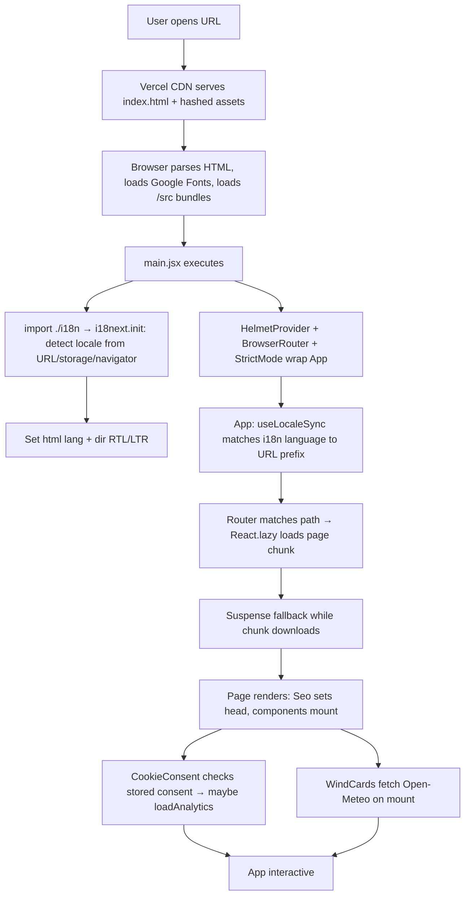

Config load = reading `import.meta.env.*` at build time (baked into the bundle). Database connect / route init / middleware = **N/A** (no server runtime). Authentication init = **N/A**.

---

## 7. Routing Architecture

**Frontend routing only** (react-router-dom v6, `BrowserRouter`). There is no backend router; the one function is a fixed path (`/api/booking`).

- **Default (English) routes:** `/`, `/experience`, `/packages`, `/courses`, `/about`, `/book`, `/privacy`.
- **Locale-prefixed routes:** the same paths under `/:lang/...` (e.g. `/de/packages`, `/ar/book`). A `LangGuard` renders `NotFound` if `:lang` isn't a supported locale.
- **Catch-all:** `*` → `NotFound`.
- **Legacy redirect (server-side, `vercel.json`):** `/programs` → `/courses` and `/:lang/programs` → `/:lang/courses` (HTTP 308).
- **SPA fallback (server-side, `vercel.json`):** `/((?!api/).*)` → `/index.html`, so deep links/refreshes resolve to the SPA instead of 404. `api/` is excluded so the function still runs.

Route → component mapping is generated from a `PAGES` array in `App.jsx`, rendered twice (bare + `/:lang` prefix). `localizePath()` builds locale-aware links; `useLocale().lp()` is the ergonomic wrapper used in components.

| Type | Where | Example |
|---|---|---|
| Public routes | all of them | `/packages` |
| Dynamic routes | locale segment `:lang` | `/it/about` |
| Nested routes | not used (flat) | — |
| Protected routes | **N/A** (no auth) | — |
| API routes | single function | `POST /api/booking` |

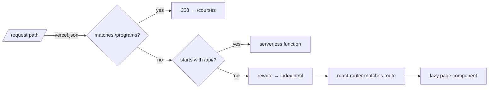

---

## 8. Authentication Flow

**N/A — the project has no authentication.** There are no users, logins, registration, password reset, JWT, OAuth, sessions, refresh tokens, or cookies-for-auth *(observed: no auth libraries in `package.json`, no login UI, no protected routes)*.

The only persisted client value is a cookie-consent flag in `localStorage` (`kp-consent`) and i18next's cached language — neither is authentication.

If auth is ever needed (e.g. an admin area for bookings), it would be added as a separate concern; see [§38](#38-improvement-roadmap).

---

## 9. Authorization Model

**N/A — no roles, permissions, guards, or protected endpoints.** All pages are public (guest access only). The closest thing to an access control is:

- `LangGuard` (`App.jsx`) — a *routing* guard that 404s unknown locale prefixes (not security).
- `api/booking.js` request gating — origin allowlist (`ALLOWED_ORIGINS`), honeypot, rate limiting, and Zod validation. This is **abuse prevention**, not user authorization. See [§22](#22-security).

---

## 10. API Documentation

One endpoint. *(observed in `api/booking.js`.)*

### `POST /api/booking`

| Field | Value |
|---|---|
| Method | `POST` (also handles `OPTIONS` preflight → 204; any other method → 405) |
| URL | `/api/booking` |
| Description | Accepts a booking enquiry, validates it, emails the operator an HTML summary + CSV attachment |
| Authentication | None (public). Gated by origin allowlist + honeypot + rate limit |
| Request headers | `Content-Type: application/json` |
| Request body | JSON matching `bookingSchema` (see below) |
| Success | `200 { ok: true }` (or `{ ok: true, note: 'received' }` when no email key configured) |
| Validation | Server-side via shared Zod `bookingSchema` |

**Request body schema** (shared `src/lib/bookingSchema.js`):

| Field | Type | Rules |
|---|---|---|
| `company` | string | **Honeypot** — must be empty |
| `fullName` | string | 2–80 chars, required |
| `email` | string | valid email, ≤120 |
| `whatsapp` | string | 6–30 chars, `^[+()\d\s-]+$` |
| `nationality` | string | 2–60, required |
| `language` | enum | English/German/French/Russian/Arabic/Italian (optional) |
| `bookingType` | enum | Pirates Week / Standalone Course / Day Experience (optional) |
| `package` | enum | one of `PACKAGE_OPTIONS` (optional) |
| `arrivalDate` | string | required, ≤20 |
| `guests` | number | int 1–10 (coerced, optional) |
| `experience` | enum | Beginner/Intermediate/Advanced/Non-kiter (optional) |
| `ownEquipment` | enum | Yes/No (optional) |
| `medical` | string | ≤1000 (optional) |
| `referral` | enum | Instagram/TikTok/Facebook/Google/Friend/Other (optional) |
| `message` | string | ≤2000 (optional) |
| `consent` | literal `true` | required (GDPR consent) |

**Error responses:**

| Status | Condition |
|---|---|
| 204 | `OPTIONS` preflight |
| 400 | invalid/unparseable JSON body |
| 403 | `Origin` not in `ALLOWED_ORIGINS` (when configured) |
| 405 | method not POST |
| 422 | body fails Zod validation |
| 429 | rate limit exceeded (>5 / 60s per IP, per instance) |
| 502 | email provider call failed |
| 200 (silent) | honeypot filled (`company` non-empty) → accepted but ignored |

**Business logic:** validate → honeypot check → build `[header,value]` field pairs → render HTML table + RFC-4180 CSV (base64) → send via Resend with the CSV attached, `reply_to` = enquirer's email. **Related files:** `api/booking.js`, `src/lib/bookingSchema.js`, `src/components/BookingForm.jsx`. Sequence: [§28](#28-sequence-diagrams).

---

## 11. Database Documentation

**N/A — there is no database.** No schema, tables, ER diagram, indexes, foreign keys, triggers, views, stored procedures, ORM, or migrations *(observed: no DB driver/ORM in dependencies; no connection code)*.

All "data" is **static content** authored as JavaScript modules in `src/data/` and localized via `src/data/content/`. The only data that leaves the browser is a single booking enquiry, which is **not stored** — it is emailed and discarded. The CSV attachment is the operator's record.

If persistence is later required (e.g. storing enquiries), see [§38](#38-improvement-roadmap) for options (a serverless DB or a CRM webhook).

---

## 12. Data Flow Documentation

### A. Page content (read path)

```mermaid
flowchart TD
  D[src/data/*.js  English canonical] --> H[useContent hook]
  O[src/data/content/{de,it,ar}.js  text overlays] --> H
  L[i18n active language] --> H
  H -->|merge by index, fallback to EN| M[localized content object]
  M --> P[Page component]
  P --> C[Presentational component props]
  C --> UI[Rendered DOM]
```

For `en`/`fr`/`ru`, `useContent` returns the English data object unchanged (no merge). For `de`/`it`/`ar`, `mergeContent` overlays translated strings onto the English structure, so **numbers/ids/icons always come from one place** (no price drift).

### B. Booking submission (write path)

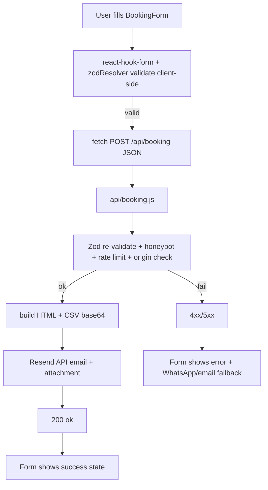

### C. Live wind (read path)

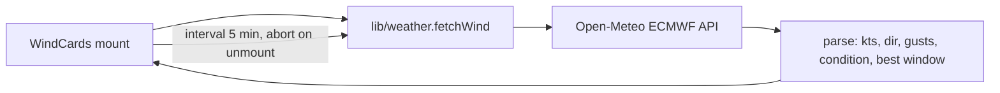

### D. Consent → analytics

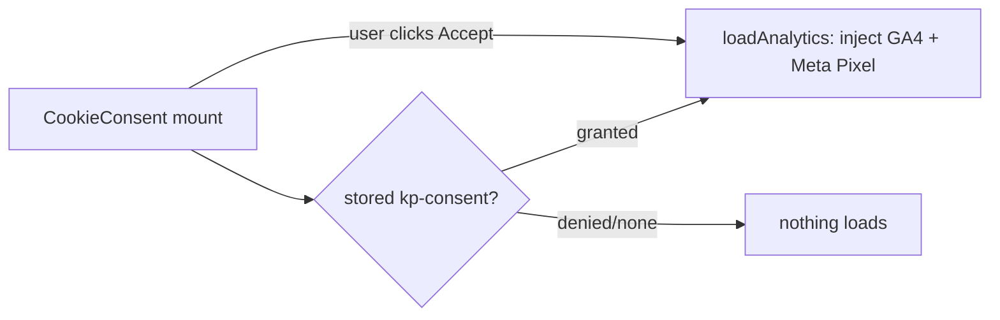

---

## 13. State Management

No global store library. State is intentionally minimal:

| Kind | Mechanism | Examples |
|---|---|---|
| Local UI state | `useState` | menu open, FAQ open index, copied flag, form status |
| Server/remote state | component-local fetch + state | `WindCards` (Open-Meteo) |
| Form state | react-hook-form | `BookingForm` |
| "Global" language | i18next (via `react-i18next` context) | active locale, RTL dir |
| Derived content | `useContent` (memoized on language) | localized data |
| Persistence | `localStorage` | `kp-consent`, i18next language cache |
| Caching/invalidation | `useMemo` in `useContent` (key = language); browser HTTP cache for assets | — |

**Not used:** Redux, Zustand, MobX, React Query / TanStack Query, Context for app data (i18next provides the only context). This is appropriate for a content site; introducing a store would add complexity without benefit.

---
## 14. Component Documentation

All components live in `src/components/`. Presentational components take data via props; interactive ones own local state. None take required props without defaults.

| Component | Purpose | Key props | Local state / hooks | Notes / performance |
|---|---|---|---|---|
| `Nav.jsx` | Fixed top nav; transparent→solid on scroll; mobile fullscreen menu | — | `useState(open)`, `useScrolled`, `useLockBody`, `useLocale`, `useTranslation` | Mobile overlay is fully opaque (readability); locale-aware links |
| `Footer.jsx` | Footer: links, social icons, language selector, share bar, wave divider | — | `useTranslation`, `useLocale` | Renders `ShareBar`, `LanguageSelector`, `BrandIcons` |
| `PageHero.jsx` | Reusable inner-page hero (sunset gradient, floating elements, wave) | `eyebrow,title,sub,height,poster,waveColor,children` | — | Used by Experience/Packages/Programs/About/Contact/Privacy |
| `Seo.jsx` | Per-route `<head>`: title, meta, canonical, hreflang ×6, OG, Twitter, JSON-LD | `meta, schemas[]` | `useLocale` | JSON-LD serialized from trusted data only |
| `Reveal.jsx` | Scroll-in animation wrapper | `direction,delay,as,className` | `useReducedMotion` | Renders static when reduced-motion |
| `Parallax.jsx` | Scroll-linked vertical shift | `speed,className` | `useScroll/useTransform`, `useReducedMotion` | Disabled under reduced-motion |
| `FloatingElements.jsx` | Decorative drifting kites/seagulls/bubbles/palms | `variant('sky'/'sea'/'beach')` | — | `aria-hidden`, pure CSS keyframes |
| `WaveDivider.jsx` | Animated SVG shoreline between sections | `color,flip,className` | — | `aria-hidden`; two drifting layers |
| `WindCards.jsx` | 4 live wind cards (hero) | — | `useState(w,err)`, `useEffect` (fetch + 5-min interval + abort), `useTranslation` | Graceful loading/offline states |
| `Primitives.jsx` | `Display`, `Eyebrow`, `Tag`, `BtnPrimary`, `BtnGhost` | varies; buttons accept `to/href/external/size` | — | Buttons add `.splash`; external links get `rel="noopener noreferrer nofollow"` |
| `ImgPlaceholder.jsx` | Real `` if `src`, else branded gradient placeholder | `src,alt,icon,label,ratio,rounded` | — | `loading="lazy"` for non-hero images |
| `PackageCard.jsx` | Package pricing card | `pkg` | `useTranslation`, `useLocale` | Featured styling; included/excluded/add-ons |
| `CourseCard.jsx` | Kite/wing course card | `course` | `useTranslation` | Private/group price split |
| `ExperienceCard.jsx` | Experience card: single, tiered, or **contact-only** (hover CTA → WhatsApp) | `exp` | `useTranslation` | `contactOnly` renders icon + name + hover overlay |
| `ComparisonTable.jsx` | Package comparison matrix | — (reads `useContent`) | `useContent` | Accessible `<table>` with row headers |
| `FAQ.jsx` | Animated accordion | `faqs` | `useState(open)`, `useReducedMotion`, `useId` | ARIA `aria-expanded`/`controls` |
| `CtaStrip.jsx` | Reusable CTA band (Book / WhatsApp / red Policies button) | `title,sub` | `useTranslation`, `useLocale` | Appears on most pages |
| `BookingForm.jsx` | The booking form | — | react-hook-form + zodResolver, `useState(status)`, `useTranslation` | Honeypot field; POSTs to `/api/booking`; success/error states |
| `WhatsAppButton.jsx` | Sticky FAB expanding to 3 flag contacts (UK/IT/DE) | — | `useState(open)`, `useTranslation` | Each flag → wa.me with prefilled, language-specific message |
| `CookieConsent.jsx` | GDPR consent banner | — | `useState(show)`, `useEffect`, `useTranslation`, `useLocale` | Gates analytics; persists choice |
| `LanguageSelector.jsx` | Language dropdown / compact row | `compact` | `useState(open)`, refs, `useNavigate`, `useTranslation` | Changes language + navigates to localized path |
| `ScrollToTop.jsx` | On route change: scroll top, or to `#hash` target | — | `useLocation`, `useEffect` | Handles `/book#policies` deep-scroll |
| `BrandIcons.jsx` | Custom SVG glyphs (TikTok, WhatsApp, X) | `className` | — | lucide lacks these brands |
| `ShareBar.jsx` | Share current page (WhatsApp/X/Facebook/Telegram/native/copy) | `className` | `useState(copied,canNativeShare)`, `useTranslation` | Reads `window.location` at click time |

Rendering flow per page: `Seo` (head) → `PageHero`/hero → `Reveal`-wrapped sections → `CtaStrip`. Page transitions handled centrally by `App.jsx` `AnimatePresence`.

---

## 15. Hooks Documentation

| Hook | File | Params | Returns | Purpose | Dependencies |
|---|---|---|---|---|---|
| `useScrolled(threshold=40)` | `hooks/useScrolled.js` | threshold px | `boolean` | True once scrolled past threshold; rAF-throttled passive listener | — |
| `useLockBody(locked)` | `hooks/useLockBody.js` | boolean | — | Locks `body` scroll while a modal/menu is open | — |
| `useLocale()` | `hooks/useLocale.js` | — | `{ locale, lp }` | Active 2-letter locale + `lp(path)` → locale-prefixed path | `react-i18next`, `lib/locale` |
| `useContent()` | `hooks/useContent.js` | — | localized content object (all collections) | Merges English data with the active language overlay; memoized on language | `react-i18next`, `lib/mergeContent`, all `data/*` |

All are client hooks (no SSR). `useContent` is the linchpin of localization — see [§12](#12-data-flow-documentation).

---

## 16. Services Layer

There is no formal "services" container. The equivalent responsibilities live in `src/lib/` and `api/`:

| "Service" | File | Responsibilities | Consumers | Business rules |
|---|---|---|---|---|
| Config | `lib/config.js` | Expose public env (WhatsApp numbers, site URL, analytics IDs, socials, email); `whatsappUrl()` builder | Nav, Footer, CtaStrip, WhatsAppButton, ShareBar, Seo, schemas | Strips non-digits from numbers; falls back to QR/Instagram if unset |
| Analytics | `lib/analytics.js` | Read/write consent; lazily inject GA4 + Meta Pixel **only after consent** | CookieConsent | `anonymize_ip`, no Google signals; nothing loads pre-consent |
| Weather | `lib/weather.js` | Fetch Open-Meteo ECMWF wind; derive compass, kite condition, best 3-h window | WindCards | Condition thresholds (kts) map to labels |
| Booking API | `api/booking.js` | Validate, gate, email enquiry + CSV | BookingForm (via fetch) | Honeypot, rate limit, origin allowlist, Zod, HTML/CSV escaping |
| SEO schema | `seo/schemas.js` | Build JSON-LD (`Organization/TouristAttraction`, `Product`, `Course`, `FAQPage`) | Seo (via pages) | Uses `config` + `SITE_URL` |

---

## 17. Utilities

| Utility | File | Input → Output | Example |
|---|---|---|---|
| `localeFromPath(pathname)` | `lib/locale.js` | path → 2-letter locale or `'en'` | `/de/book` → `de` |
| `stripLocale(pathname)` | `lib/locale.js` | path → path without locale prefix | `/de/book` → `/book` |
| `localizePath(barePath, locale)` | `lib/locale.js` | path + locale → localized path | `('/book','de')` → `/de/book` |
| `mergeItem` / `mergeCollection` | `lib/mergeContent.js` | base + override → deep-merged (numbers preserved, arrays by index, missing → base) | see [§12](#12-data-flow-documentation) |
| `bookingSchema`, `PACKAGE_OPTIONS` | `lib/bookingSchema.js` | — | Zod schema shared client+server |
| `degToCompass`, `conditionFor`, `fetchWind`, `REFRESH_MS`, `DATA_SOURCE` | `lib/weather.js` | wind degrees/speed → labels; endpoint fetch | `degToCompass(315)` → `NW` |
| `pageMeta`, `KEYWORDS` | `seo/meta.js` | per-route title/description/slug/path | — |

SEO data (`data/*.js`) is documented as content, not utilities; see [§12](#12-data-flow-documentation).

---

## 18. Configuration

**Build-time public config** is read via `import.meta.env.VITE_*` and **baked into the bundle** — never treat `VITE_*` as secret. **Server secrets** (no `VITE_` prefix) are read only inside `api/booking.js`.

| Variable | Scope | Purpose |
|---|---|---|
| `VITE_WHATSAPP_NUMBER` | public | Main WhatsApp number (default `201225099809`) |
| `VITE_WHATSAPP_NUMBER_UK/IT/DE` | public | Per-language WhatsApp contacts (fallback to main) |
| `VITE_SITE_URL` | public | Canonical/hreflang/JSON-LD origin (default `https://kitepirateshurghada.com`) |
| `VITE_GA4_ID`, `VITE_META_PIXEL_ID` | public | Analytics IDs (blank = analytics off) |
| `BOOKING_EMAIL_API_KEY` | **secret** | Resend API key (Vercel env only) |
| `BOOKING_TO_EMAIL`, `BOOKING_FROM_EMAIL` | secret/config | Recipient & sender for enquiries |
| `ALLOWED_ORIGINS` | secret/config | CORS allowlist for the booking API |

Config files: `vite.config.js` (chunking), `tailwind.config.js` (theme/keyframes/fonts), `postcss.config.js`, `vercel.json` / `netlify.toml` (headers, redirects, SPA), `.eslintrc.cjs`, `src/styles/tokens.css` (design tokens). **Feature flags / runtime config:** none beyond the above env vars *(observed)*.

---

## 19. Middleware

**No app/server middleware framework** (no Express). Two analogues exist:

1. **In-function gating** in `api/booking.js`, executed in this order *(observed)*:
   `CORS headers → OPTIONS short-circuit (204) → method check (405) → origin check (403) → rate limit (429) → JSON parse (400) → honeypot (silent 200) → Zod validate (422) → email send (200/502)`.
2. **Edge config** in `vercel.json`: security headers, redirects (`/programs`→`/courses`), and the SPA rewrite. These run at the CDN/edge before the static asset or function.

Client-side "middleware" analogues: `App.jsx` `useLocaleSync` (effect syncing locale to URL) and `LangGuard` (route guard).

---

## 20. Error Handling

| Area | Handling |
|---|---|
| Booking submit (client) | `try/catch` around `fetch`; non-2xx → error state with WhatsApp/email fallback message |
| Booking API (server) | Structured status codes (400/403/405/422/429/502); `try/catch` around Resend; failures logged + 502 |
| Weather fetch | `fetchWind` throws on non-OK; `WindCards` `.catch` (ignores `AbortError`) → shows `—` / offline note |
| Clipboard / native share | `try/catch`, silently ignore (`ShareBar`) |
| Analytics storage | `try/catch` around `localStorage` (fail-closed: no tracking) |
| Routing | Unknown route or bad locale → `NotFound` (`noindex`) |
| Reduced motion | Animations degrade gracefully (no errors) |
| Fallback UI | `Suspense` fallback (branded splash) while lazy chunks load |

There is **no global React error boundary** *(observed)* — a render-time exception in a page would blank the app. See [§37](#37-code-quality-assessment) (recommended addition).

---

## 21. Logging

- **Client:** no logging framework; no `console.*` noise in production paths.
- **Server (`api/booking.js`):** `console.warn`/`console.error` for "email key not set" and send failures → captured in **Vercel function logs**. **No PII is logged** (the visitor email was removed from logs in the security pass).
- **Analytics** (consent-gated GA4 / Meta Pixel) provides traffic monitoring, not application logs.
- **Audit logs / monitoring stack:** none beyond Vercel's built-in logs & (optional) Vercel Analytics/Speed Insights.

---

## 22. Security

Threat surface is small (static site + one POST). Controls *(observed)*:

| Control | Implementation |
|---|---|
| Secrets management | Only `VITE_*` (public) in bundle; real secrets in Vercel env; `.env` git-ignored; `.env.example` has placeholders |
| Input validation | Zod schema shared **client + server**; length caps; enums |
| Injection (XSS) | React auto-escaping; **no `dangerouslySetInnerHTML`/`eval`**; JSON-LD from trusted data; email HTML-escaped; CSV cells RFC-4180 quoted |
| SQL / command injection | **N/A** (no DB/shell) |
| CSRF | No cookies/sessions → no CSRF surface; POST is stateless JSON |
| CORS | `ALLOWED_ORIGINS` allowlist in `api/booking.js` (set in Vercel) |
| Rate limiting | In-memory per-instance (5/60s) — slows abuse; **not** a true distributed limiter |
| Bot mitigation | Hidden honeypot `company` field (silently accepted) |
| Secure headers | `vercel.json`/`netlify.toml`: CSP, HSTS, `X-Content-Type-Options`, `X-Frame-Options: DENY`, `Referrer-Policy`, `Permissions-Policy`, COOP |
| Transport | HTTPS auto (Vercel); HSTS preload |
| Privacy | Consent-gated analytics; `anonymize_ip`; minimal `localStorage`; translated Privacy page |
| Dependencies | `npm audit --omit=dev` = **0**; one dev-only esbuild advisory remains (needs breaking vite 8) |

**Potential vulnerabilities / residual risk:** rate limiter is per-instance (recommend edge/WAF limiting); `ALLOWED_ORIGINS` must actually be set in prod or origin enforcement is skipped; booking enquiries traverse a third party (Resend); JSON-LD `<`-escaping is a low-priority hardening not yet applied. See [§37](#37-code-quality-assessment).

---

## 23. Performance

| Technique | Where |
|---|---|
| Code splitting | Every page is `React.lazy` + `Suspense`; manual vendor chunks in `vite.config.js` (react, motion, i18n, forms) |
| Lazy images | `ImgPlaceholder` uses `loading="lazy"`; hero uses eager + `fetchPriority="high"` (LCP) |
| Memoization | `useContent` memoized on language; rAF-throttled scroll listener |
| Reduced motion | All animations honour `prefers-reduced-motion` |
| Asset caching | `/assets/*` `Cache-Control: immutable` (1 yr) via headers config |
| Fonts | `preconnect` + `display=swap` |
| CDN | Vercel global edge |
| Network hygiene | Weather fetch aborts on unmount, refreshes every 5 min |

**Bottlenecks / notes:** `useContent` statically imports all three language overlays, so the content chunk (~50 KB) loads even for English visitors — a candidate for per-language lazy-loading if bundle size matters (low priority).

---

## 24. Deployment

**Build process:** `npm run build` → `vite build` → static output in `dist/` (HTML, hashed JS/CSS). `api/` becomes a Vercel serverless function automatically.

**CI/CD:** GitHub → Vercel Git integration. Push to `main` → Vercel installs, builds, and deploys to production (auto). Preview deployments for other branches.

**Environment setup:** set env vars in Vercel dashboard (see [§18](#18-configuration)); secrets never in repo.

**Docker / Docker Compose:** **N/A** (not containerized; Vercel-native).

**Domain:** `kitepirateshurghada.com` registered at Tasjeel; apex `A → 216.198.79.1`, `www CNAME → *.vercel-dns`; apex 308-redirects to www. HTTPS auto.

**Rollback:** Vercel keeps prior deployments — "Promote to Production" on a previous build, or revert the Git commit.

**Health checks / scaling:** static assets are CDN-served (effectively infinite scale); the function scales on demand (stateless). No custom health endpoint (not needed).

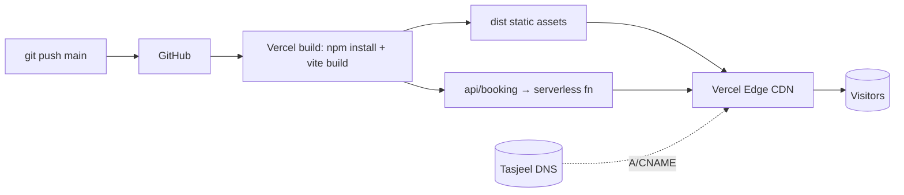

---

## 25. Testing

**No automated tests exist** *(observed: no test script, framework, or test files)*. Quality is currently guarded by:

- **ESLint** (`npm run lint`) — catches undefined refs, unused vars, React rules.
- **Production build** — type-free but catches import/syntax errors.
- **Manual smoke tests** after deploy (navigation, refresh on deep routes, language switch, booking submit).

**Recommended testing strategy** (see [§38](#38-improvement-roadmap)): Vitest + React Testing Library for `mergeContent`, `localizePath`, `bookingSchema`, and a render test per page; a Playwright E2E for the booking happy-path and the `/programs→/courses` redirect. Given there are no tests, **no refactor in this codebase should be called "safe" without a manual smoke test.**

---

## 26. Dependency Analysis

**External runtime deps:** react, react-dom, react-router-dom, framer-motion, i18next (+browser-languagedetector), react-i18next, react-hook-form, @hookform/resolvers, zod, react-helmet-async, lucide-react. **Dev:** vite, @vitejs/plugin-react, tailwindcss, postcss, autoprefixer, eslint(+plugins). **External services (not npm):** Resend, Open-Meteo, GA4/Meta, Google Fonts.

| Aspect | Status |
|---|---|
| Critical packages | react/react-dom, react-router-dom, vite, i18next, zod |
| Unused packages | none significant *(observed; ESLint clean)* |
| Production vulns | **0** (`npm audit --omit=dev`) |
| Dev-only vulns | 1 (esbuild via vite; fix = breaking vite 8 — deferred) |
| Version posture | pinned exact in `package.json` + lockfile committed |
| Notable available majors (not applied) | react 19, react-router 7, tailwind 4, zod 4, vite 8, framer-motion 12, i18next 26 |

Internal dependencies: see graphs in [§31](#31-folder-dependency-graph)–[§32](#32-module-dependency-graph).

---
## 27. Design Patterns

| Pattern | Where / how | Why |
|---|---|---|
| Presentational/Container split | Pages source data (`useContent`); components are presentational (props) | Reusable, translation-agnostic cards |
| Custom Hooks (composition) | `useLocale`, `useContent`, `useScrolled`, `useLockBody` | Encapsulate cross-cutting logic; reactivity on language change |
| Adapter | `mergeContent` adapts English structure + translation overlay → localized object | Keeps numbers single-sourced |
| Strategy | `ExperienceCard` renders single / tiered / contact-only by shape; `FloatingElements` by `variant` | One component, multiple behaviours |
| Facade | `lib/config`, `seo/schemas`, `lib/weather` hide details behind simple functions | Simpler call sites |
| Module/Singleton | i18next instance (`src/i18n/index.js`) initialized once, imported everywhere | Single locale source |
| Guard | `LangGuard` (route), API gating chain | Reject invalid input early |
| Render-props / children | `PageHero`/`CtaStrip` accept `children` | Flexible composition |
| Honeypot | hidden `company` field | Bot mitigation |

**Not used:** Factory, Repository, Dependency Injection container, Observer (beyond React/i18next), Builder, Decorator, Singleton-as-service — unnecessary at this scale.

---

## 28. Sequence Diagrams

**Booking submission (the main interactive flow):**

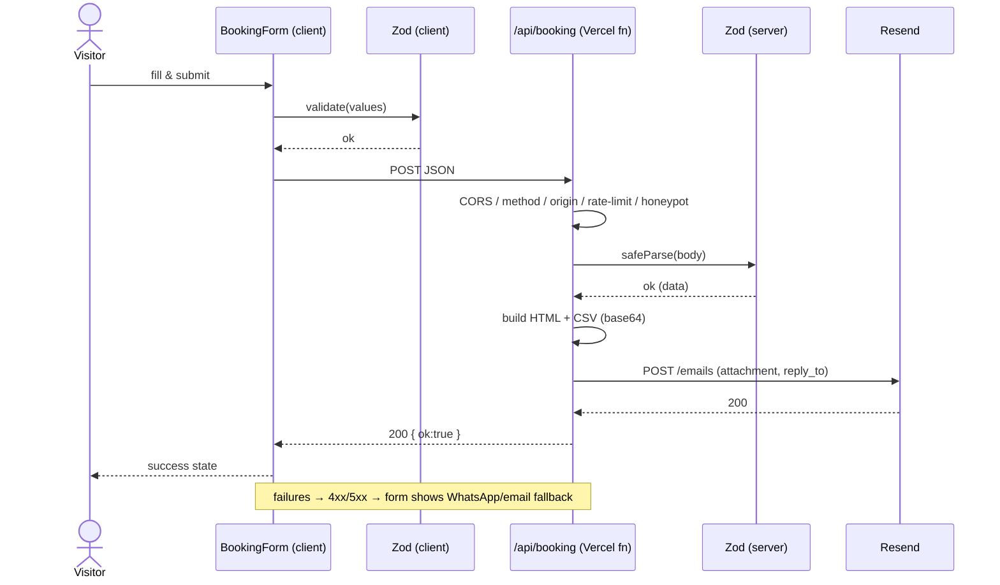

**Live wind cards:**

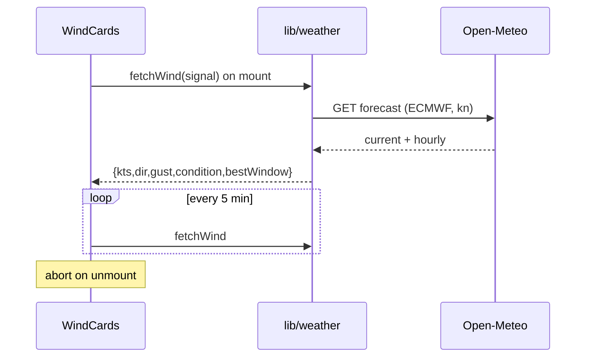

**Language switch:**

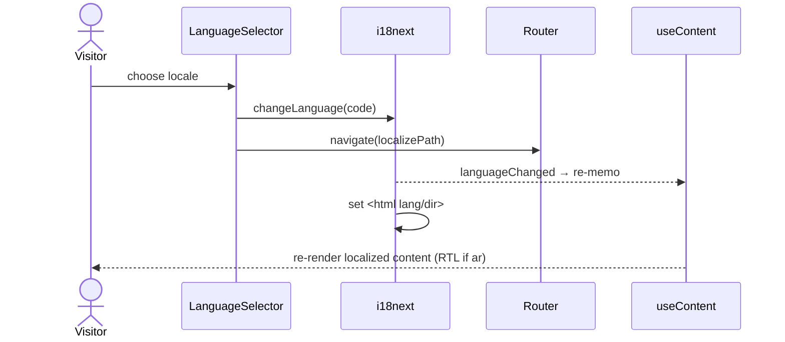

Authentication / registration / payment / file upload / notification sequences: **N/A** (features not present).

---

## 29. Class / Module Diagrams

No classes (functional codebase). Module relationships for the localization core:

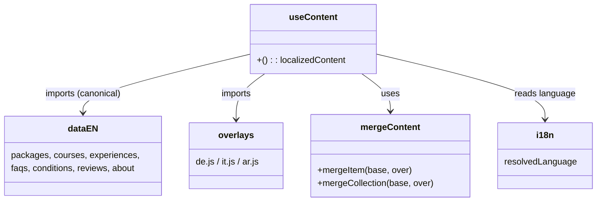

---

## 30. Architecture Diagrams

**System / deployment:**

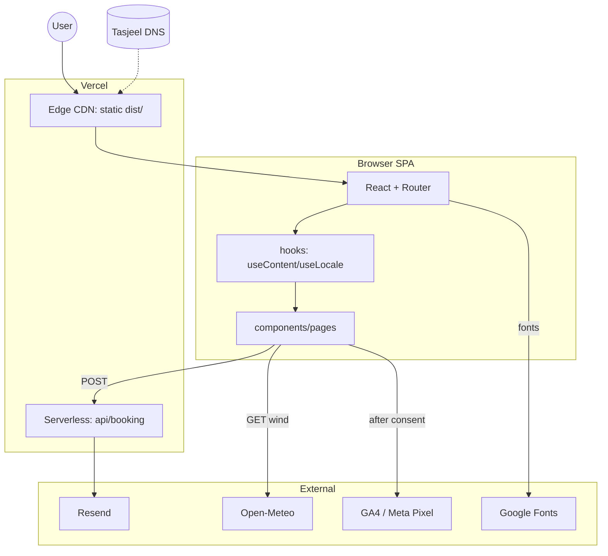

**Layer architecture:**

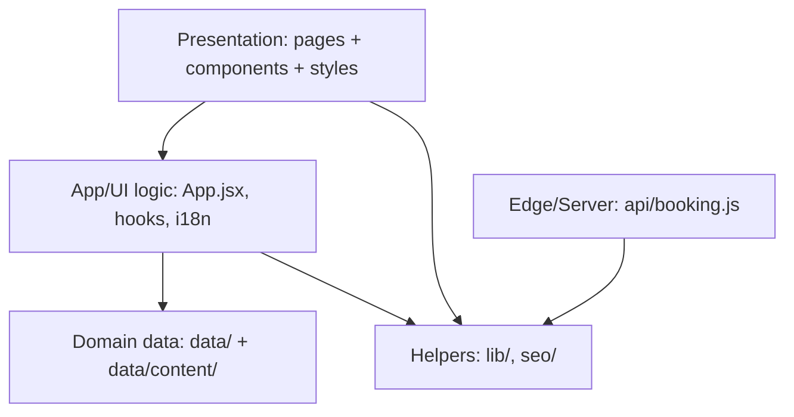

---

## 31. Folder Dependency Graph

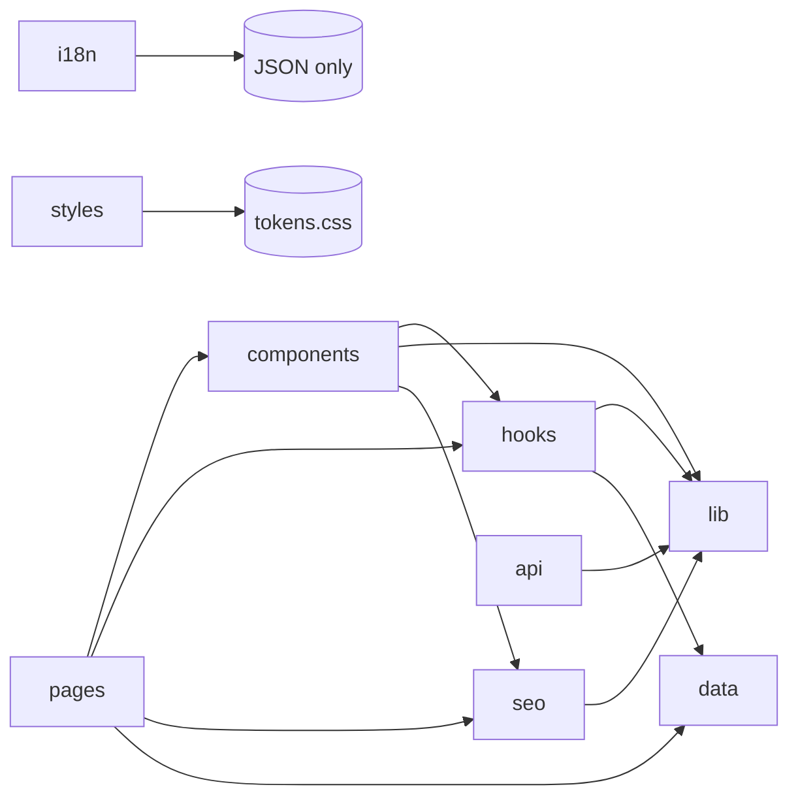

*(observed)* `data/` depends on nothing app-specific (pure content). `lib/` is leaf-most (depends only on `i18n`/env). `api/` depends only on `lib/bookingSchema`.

---

## 32. Module Dependency Graph

Key edges (selected):

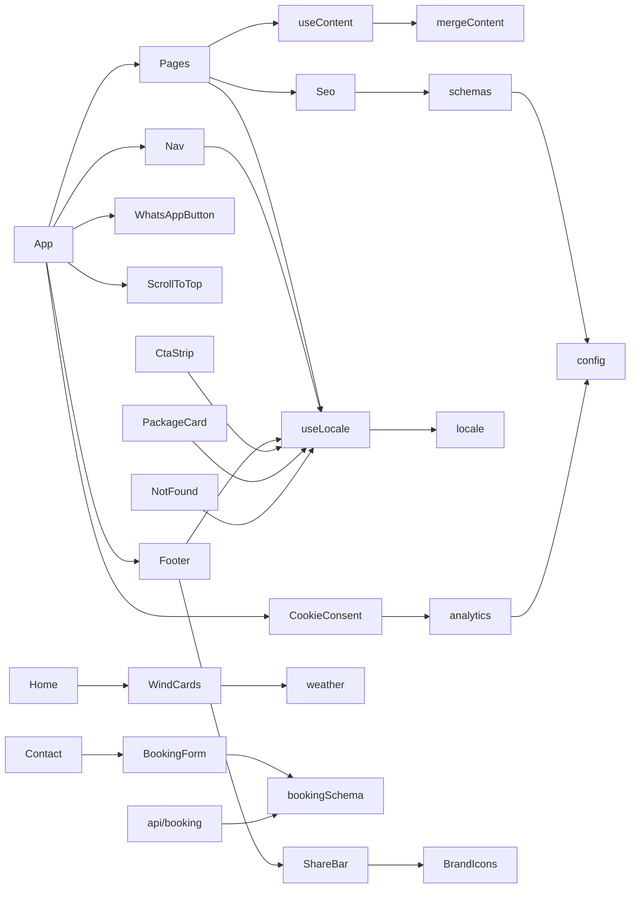

---

## 33. Request Lifecycle

**Static page request** (e.g. `/de/packages`):

1. DNS resolves `kitepirateshurghada.com` → Vercel edge.
2. Edge applies `vercel.json`: security headers; checks redirects (`/programs`→`/courses`); request isn't `/api/*`, so SPA rewrite → serves `index.html`.
3. Browser loads `index.html` → fonts + hashed JS/CSS from CDN.
4. `main.jsx` runs → i18next initializes, detects `de` from the path → sets `<html lang="de" dir="ltr">`.
5. Router matches `/:lang/packages` → `LangGuard` validates `de` → lazy-loads `Packages` chunk (Suspense fallback meanwhile).
6. `Packages` calls `useContent()` → merges German overlay onto English data → renders cards + `ComparisonTable`; `Seo` writes localized head + JSON-LD.
7. Consent banner checks storage; if previously granted, analytics inject.

**API request** (`POST /api/booking`): edge routes to the function (rewrite excludes `/api/`) → gating chain ([§19](#19-middleware)) → Resend → JSON response. See [§28](#28-sequence-diagrams).

---

## 34. Build Pipeline

| Stage | Tool | Notes |
|---|---|---|
| Install | npm | lockfile v3, exact pins |
| Transform | Vite + @vitejs/plugin-react (esbuild) | JSX→JS; **no TypeScript compilation** (JS project) |
| CSS | PostCSS + Tailwind + autoprefixer | Tailwind JIT scans `content` globs; tokens via CSS vars |
| Bundle | Rollup (via Vite) | ES modules → hashed chunks |
| Tree shaking | Rollup | dead-code elimination |
| Code splitting | Vite | per-page lazy chunks + manual vendor chunks (`react`, `motion`, `i18n`, `forms`) |
| Minify | esbuild | JS/CSS minification |
| Asset hashing | Vite | cache-busting filenames; `public/` copied verbatim |
| Output | `dist/` | deployed by Vercel |

Run locally: `npm run dev` (HMR), `npm run build`, `npm run preview`, `npm run lint`.

---

## 35. Common Development Tasks

| Task | Steps |
|---|---|
| **Add a page** | Create `src/pages/Foo.jsx`; add `{ path:'foo', element:<Foo/> }` to `PAGES` in `App.jsx` (lazy import); add `pageMeta.foo` in `seo/meta.js`; add nav entry in `Nav.jsx`/`Footer.jsx`; add to `public/sitemap.xml` generator; add UI strings to all `i18n/*.json`. |
| **Add an API route** | Add `api/<name>.js` (Vercel auto-detects); keep validation in `lib/` and share schema; ensure `vercel.json` rewrite still excludes `api/`. |
| **Add a DB table** | **N/A** (no DB). If introducing persistence, add a serverless DB/CRM and a new function — see [§38](#38-improvement-roadmap). |
| **Create a component** | Add to `src/components/`; presentational → props; interactive → local state/hooks; use Tailwind + tokens; honour reduced-motion. |
| **Create a service/helper** | Add a pure module to `src/lib/`; no React imports if avoidable. |
| **Create a hook** | Add to `src/hooks/`; prefix `use`; keep dependency arrays correct. |
| **Add content** | Edit English `src/data/*.js` (canonical); add translations to `src/data/content/{de,it,ar}.js` mirroring the array order (missing → English fallback). |
| **Add a language** | Add JSON in `src/i18n/`; register in `i18n/index.js` `LOCALES`; (optional) add `data/content/<lang>.js` + register in `useContent`; sitemap will include it. |
| **Add middleware** | Extend the gating chain in `api/booking.js`, or add edge rules in `vercel.json`. |
| **Add authentication / permissions** | Not present; would be a new architecture decision — see [§38](#38-improvement-roadmap). |

---

## 36. Troubleshooting Guide

| Symptom | Likely cause | Fix / debug |
|---|---|---|
| Refresh on `/courses` → 404 | SPA rewrite missing/overridden | Ensure `vercel.json` `rewrites` `/((?!api/).*) → /index.html`; redeploy |
| Booking form shows success but no email | `BOOKING_EMAIL_API_KEY` unset or env not redeployed | Set key in Vercel env, **redeploy**; check Resend dashboard logs |
| Email send fails (502) | Resend rejects sender/recipient (test mode) | Use `onboarding@resend.dev` + your Resend account email, or verify domain |
| Content stays English in AR/IT/DE | Missing/misaligned overlay entry | Check the matching index in `data/content/<lang>.js`; missing → English by design |
| Whole page blank after an edit | Render exception (no error boundary) | Check browser console; consider adding an error boundary ([§37](#37-code-quality-assessment)) |
| Site loads on `*.vercel.app` not custom domain | Browsing via deployment URL / DNS not propagated | Use `kitepirateshurghada.com`; verify A/CNAME; `whatsmydns.net` |
| Wind cards show `—` | Open-Meteo unreachable / CSP `connect-src` missing | Confirm `api.open-meteo.com` in CSP `connect-src` |
| Deploy builds old commit | push didn't reach `main` / manual redeploy of old build | Confirm `git push` shows `-> main`; check Deployments commit hash |
| `npm install` EPERM / can't find package.json | running inside the sandbox AppData path or wrong cwd | Work in `C:\Users\<you>\Documents\kite-pirates` |
| ESLint "Unexpected character" at EOF | stray null bytes from a copy | strip with `tr -d '\000'` (build-dir artifact only) |

---

## 37. Code Quality Assessment

**Strengths:** clean separation (data/UI/helpers), localization isolated behind one hook with crash-safe merge, consistent Tailwind tokens, accessibility (focus rings, ARIA, reduced-motion, RTL), 0 production-dependency vulnerabilities, ESLint clean.

| Finding | Severity | Recommendation |
|---|---|---|
| **No automated tests** | High (maintainability) | Add Vitest for `mergeContent`/`localizePath`/`bookingSchema`; one render test/page; Playwright booking E2E |
| **No React error boundary** | Medium | Add a top-level boundary in `App.jsx` to avoid full blank on render error |
| Rate limiter is per-instance | Medium (security) | Add edge/WAF rate limiting (Vercel) for the function |
| `ALLOWED_ORIGINS` optional | Low/Medium | Set it in prod env so origin enforcement is active |
| No TypeScript | Medium | Optional: migrate to TS for content shapes + props safety |
| Content overlays loaded eagerly | Low (perf) | Lazy-load per-language overlay if bundle grows |
| JSON-LD not `<`-escaped | Low | Escape `<`→`<` in `Seo` (defense-in-depth) |
| Long page components | Low | Acceptable (section JSX); split only if reused |
| SEO `<title>`/meta English for all locales | Low (SEO) | Localize `pageMeta` per language |
| Privacy text is a template | Low (legal) | Add legal entity details; lawyer review |

No tight coupling or duplicated logic of concern remains (locale boilerplate was consolidated into `useLocale`).

---

## 38. Improvement Roadmap

**Short-term (days):**
- Add an error boundary; localize SEO `pageMeta`; set `ALLOWED_ORIGINS`; finish FR/RU content (add `data/content/{fr,ru}.js`); supply OG images + logo; replace placeholder reviews.

**Medium-term (weeks):**
- Introduce Vitest + RTL + a Playwright happy-path; add edge rate limiting; verify Resend domain (send from `bookings@kitepirateshurghada.com`); add Google Search Console + Business Profile; consider lazy per-language overlays.

**Long-term (architecture):**
- Optional TypeScript migration for type-safe content/props.
- If enquiries need persistence/CRM: add a serverless DB (e.g. Vercel Postgres/KV) or a CRM webhook, with a real distributed rate limiter and an admin view (this would introduce the first auth requirement).
- Consider a headless CMS if non-developers must edit content frequently (today content is code).
- Evaluate framework move to a meta-framework (e.g. Next.js/Astro) **only** if SSR/SEO needs outgrow the current static SPA — not required today.

**Refactoring opportunities:** per-language overlay lazy-loading; extract repeated section wrappers if more pages appear; centralize the experience-card "shape" detection if more variants are added.

**Scalability:** static + CDN already scales effectively without limit; the only stateful-ish concern is the booking function's per-instance rate limiter and the external email quota — address both before high-traffic campaigns.

---

*End of documentation. Generated by reverse-engineering the source; keep in sync with code changes (especially [§10](#10-api-documentation), [§14](#14-component-documentation), [§18](#18-configuration)).*


